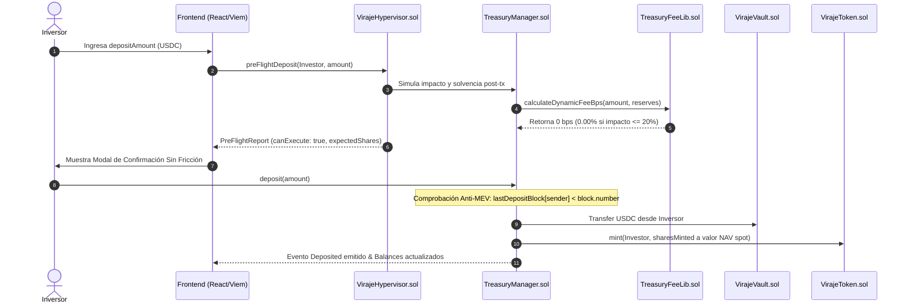
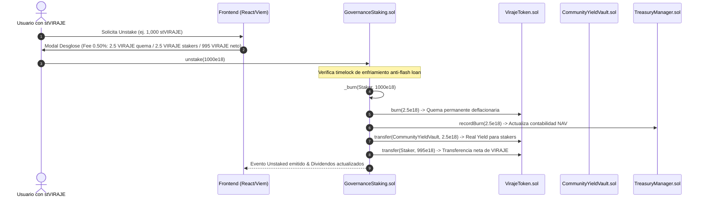

# Especificación Técnica y Arquitectura Institucional: Protocolo Viraje Protocol (v7.0 Enterprise Pure DeFi - Mainnet Ready)

**Versión:** 7.0.0-Institutional (Pure DeFi)  
**Fecha:** Noviembre 2026  
**Clasificación:** Infraestructura Descentralizada Institucional (Pure DeFi / MiCA Considerando 22)  
**Red Canónica:** Arbitrum Sepolia (`421614`) / Arbitrum One (`42161`)  

---

## 1. Visión General, Filosofía & Invariantes Institucionales

El **Protocolo Viraje Protocol** es una infraestructura financiera descentralizada (*Pure DeFi*) de grado institucional diseñada para la emisión, custodia y comercialización de un activo patrimonial de cuota de reserva respaldado por colateral exógeno ($VIRAJE$). El protocolo opera de forma inmutable sobre Ethereum Virtual Machine (EVM) y capas de escalado Layer-2 (Arbitrum), integrando gobernanza timelocked de cero privilegios corporativos, oráculos multicapa de alta resiliencia, un centinela pre-transaccional de simulación de invariantes ([`VirajeHypervisor.sol`](../contracts/src/VirajeHypervisor.sol)) y un mercado monetario Peer-to-Peer (P2P) colateralizado por Tokens No Fungibles (NFTs ERC-721).

### 1.1. Invariantes Matemáticas y Defensas Formales

El núcleo determinista del protocolo se rige por cinco invariantes matemáticas estrictas que son verificadas on-chain en tiempo real antes de confirmar cualquier transacción de emisión, rescate, colateralización o distribución de comisiones:

#### 1. Invariante de Proof of Reserves (PoR) $\ge 100.00\%$
Cada token $VIRAJE$ emitido y en circulación libre está respaldado en todo momento por reservas líquidas y exógenas de primera línea (USDC, WBTC, WETH). En ningún momento el pasivo circulante puede exceder el valor neto realizable de la reserva:

$$\text{ProofOfReservesRatio} = \frac{\text{TotalAssetsUSD}_{\text{exogenous}}}{\text{TotalLiabilitiesUSD}_{\text{circulating}}} \ge 1.0000 \quad (100.00\%)$$

#### 2. Monotonicidad Estricta del NAV Spot ($\Delta NAV_{\text{spot}} \ge 0$)
Ninguna operación dentro del protocolo (depósito, rescate, emisión de bonos vestados, préstamo P2P, liquidación por oráculo o quema deflacionaria) puede resultar en una disminución del Valor Patrimonial Neto por share ($NAV_{\text{spot}}$). Si una transacción degradara el NAV por share, el contrato de validación [`ProtocolTokenomicsEngine.sol`](../contracts/src/ProtocolTokenomicsEngine.sol) y [`TreasuryManager.sol`](../contracts/src/TreasuryManager.sol) emiten un `revert` atómico:

$$NAV_{\text{spot}} = \frac{\text{NetEquityUSD}_{\text{exogenous}}}{\text{NetCirculatingShares}_{\text{VIRAJE}}}$$

$$NAV_{t+1} \ge NAV_t$$

#### 3. Centinela de Invariantes Pre-Vuelo (`VirajeHypervisor.sol`)
Para erradicar transacciones fallidas y proteger a los usuarios de picos de gas artificiales en MetaMask (30M gas limit por revert de EVM), el centinela evalúa la transacción antes de su envío:
* Certifica solvencia post-ejecución $\ge 100\%$.
* Verifica que el endeudamiento respete el techo prudencial de colateral reflexivo ($3,435.41 USDC máx.).
* Asegura que los oráculos Chainlink/Pyth cumplan con los límites de frescura ($\le 24\text{h}$) y que el secuenciador L2 esté activo.

#### 4. Cumplimiento Regulatorio MiCA Pure DeFi (Exención Recital 22)
El protocolo prescinde de cualquier figura corporativa centralizada, custodios fiduciarios, llaves privadas de administración o denominaciones de vehículos de inversión sujetas a autorización ART (*Asset-Referenced Tokens* de acuerdo con el Reglamento EU 2023/1114). Todas las cuotas generadas se distribuyen de manera inmutable: 50% a reservas (acreciendo NAV) y 50% a [`CommunityYieldVault.sol`](../contracts/src/CommunityYieldVault.sol) para dividendos líquidos de stakers.

#### 5. Protección Anti-MEV y Cooldown Same-Block
Para neutralizar ataques atómicos de sándwich y arbitraje de NAV mediante *Flash Loans* en el mismo bloque de ejecución, los contratos de tesorería imponen una restricción de altura de bloque por cuenta:

$$\text{require}(\text{lastDepositBlock}[\text{msg.sender}] < \text{block.number}, \text{"Same-block deposit/redeem cooldown"})$$

---

## 2. Topología General de Arquitectura y Diagramas de Flujo

### 2.1. Mapa Completo de Componentes por Capas

```mermaid
graph TD
    subgraph UI ["CAPA DE PRESENTACIÓN (React 18 + Vite + Viem)"]
        Shell["App.tsx (Main Layout & Providers)"]
        Web3State["useWeb3State.ts (Polling Multi-Call Reader)"]
        DashboardUI["MetricsDashboard.tsx (PoR, Solvency & Proof of Reserves)"]
        TreasuryUI["TreasuryDashboard.tsx (Deposit USDC 0% / Redeem VIRAJE 1%)"]
        StakingUI["GovernanceStakingUI.tsx (stVIRAJE Real Yield Pool: 0% in / 0.50% out)"]
        BondsUI["VestedVaults.tsx (NFT Bond Engine: 10%-50% Descuento)"]
        P2PUI["P2PMarketplace.tsx (P2P Collateralized Lending: 6.00% APR)"]
        GovUI["GovernanceCommandCenter.tsx (DAO Timelock Proposals 72h)"]
        ModalApy["ApyBreakdownModal.tsx (On-Chain Yield Oracle Math)"]
    end

    subgraph ONCHAIN ["CAPA SMART CONTRACTS (Solidity 0.8.20 + OpenZeppelin v5)"]
        Registry["ProtocolAddressProvider.sol (Service Locator Registry)"]
        Hypervisor["VirajeHypervisor.sol (Pre-Flight Sentinel & Invariant Simulator)"]
        
        subgraph CORE ["Núcleo de Emisión, Tesorería & Librerías EIP-170"]
            Treasury["TreasuryManager.sol (Pure DeFi NAV & Orchestrator)"]
            FeeLib["TreasuryFeeLib.sol (Dynamic Slippage & Anti-Whale)"]
            PoRLib["TreasuryPoRLib.sol (Proof of Reserves & Solvency Audit)"]
            RebalanceLib["TreasuryRebalanceLib.sol (Optimal Multi-Asset Swaps)"]
            Vault["VirajeVault.sol (Exogenous Asset Cold Bunker)"]
            Token["VirajeToken.sol (ERC-20 VIRAJE)"]
            Engine["ProtocolTokenomicsEngine.sol (Pure Math Engine)"]
            Buyback["DiscountBuybackEngine.sol (10-Lock Buyback & Burn)"]
        end

        subgraph ORACLES ["Oráculos, Seguridad L2 & Post-Quantum"]
            PriceHub["OracleHub.sol (Dual Oracles + L2 Sequencer Grace Period)"]
            YieldOracle["DynamicYieldOracleRouter.sol (Passive Yield APYs)"]
            Breaker["CircuitBreaker.sol (Volatility Freeze Guard)"]
            PQGuard["PostQuantumGuard.sol (W-OTS+ NIST SP 800-208 Signatures)"]
        end

        subgraph YIELD ["Ecosistema Real Yield & Gobernanza DAO"]
            Staking["GovernanceStaking.sol (stVIRAJE & Voting Checkpoints)"]
            Router["RealYieldRouter.sol (50/50 Universal Fee Enforcer)"]
            YieldVault["CommunityYieldVault.sol (50% Staker Dividends)"]
            Governor["GovernorViraje.sol (DAO Executive)"]
            Timelock["TimelockController.sol (72h Delay)"]
        end

        subgraph MARKET ["Mercados Monetarios & Productos Estructurados"]
            VestedVault["VestedDiscountVault.sol (Bond Discount Pricing 10%-50%)"]
            NFT["VaultPositionNFT.sol (ERC-721 Collateral NFT - Packed Storage)"]
            P2P["P2PLendingMarket.sol (Escrow & Asymmetric Grace Period)"]
            Morpho["MorphoYieldVaultAdapter.sol (80% MetaMorpho Yield)"]
        end
    end

    Shell --> Web3State
    Web3State --> Registry
    Web3State --> Hypervisor
    Web3State --> Treasury
    Web3State --> Staking
    
    TreasuryUI --> Hypervisor
    Hypervisor --> Treasury
    Treasury --> FeeLib
    Treasury --> PoRLib
    Treasury --> RebalanceLib
    Treasury --> Vault
    Treasury --> Engine
    
    StakingUI --> Staking
    Staking --> Router
    BondsUI --> VestedVault
    P2PUI --> P2P
    P2P --> NFT
    P2P --> Treasury
    
    Router --> Vault
    Router --> YieldVault
```



---

### 2.2. Diagrama de Secuencia: Acuñación Sin Fricción (0.00%) y Reparto de Rendimiento



---

### 2.3. Diagrama de Secuencia: Des-staking con Comisión de Salida (0.50%)



---

## 3. Especificación Detallada de los 28 Smart Contracts y Librerías

### 3.1. Módulo 1: Núcleo de Emisión y Tesorería Exógena

#### 0. [`TreasuryProxy.sol`](../contracts/src/TreasuryProxy.sol)
- **Propósito**: Proxy de actualización canónico EIP-1967 que canaliza la ejecución y preserva el estado y fondos de la tesorería institucional delegando en `TreasuryManager.sol`.
- **Invariante de Almacenamiento**: No declara variables secuenciales en almacenamiento (slots 0, 1... libres); utiliza exclusivamente los slots de constantes canónicas EIP-1967 (`keccak256("eip1967.proxy.implementation") - 1` y `keccak256("eip1967.proxy.admin") - 1`), erradicando colisiones de almacenamiento con librerías o implementaciones.
- **Seguridad y Gobernanza**: Las funciones administrativas (`upgradeTo`, `upgradeToAndCall`, `changeAdmin`) están restringidas a `onlyOwner` (asignado incondicionalmente a `TimelockController.sol` con retardo obligatorio de 72 horas en producción). Soporta migraciones atómicas con propagación de errores (`revert`) y enrutamiento canónico seguro de `receive()` y `fallback()`.

#### 1. [`TreasuryManager.sol`](../contracts/src/TreasuryManager.sol)
- **Propósito**: Orquestador central de emisión a NAV, rescates, rebalanceos y control estricto de solvencia.
- **Modularización EIP-170**: Para permanecer por debajo del límite de 24.576 bytes, delega su lógica matemática en `TreasuryFeeLib`, `TreasuryPoRLib` y `TreasuryRebalanceLib`.
- **Invariantes Financieros y Regulatorios**:
  - **Monotonicidad de NAV ($\Delta NAV \ge 0$)**: Impide matemáticamente que cualquier depósito o rescate reduzca el valor patrimonial neto por share.
  - **Monotonicidad de Solvencia ($\Delta \text{Solvency} \ge 0$)**: Exige que el ratio de colateralización de Proof of Reserves no decaiga.
  - **Inmunidad Anti-MEV / Flash Loans**: `SameBlockCooldown` prohíbe interactuar en depósito y rescate dentro del mismo bloque para el usuario o beneficiario.
  - **Facilidad de Crédito P2P (C-03)**: Limita la exposición agregada de préstamos de tesorería a un máximo configurable del 20% (techo institucional incondicional del 50%) de las reservas líquidas de stablecoins.
  - **Deducción de Pasivos Vested (C-02)**: Ejecuta `_accrueVestedVault()` antes de cada cómputo de NAV para garantizar la valoración justa del equity neto.
  - **Aislamiento Regulatorio (C-01)**: Vincula criptográficamente `msg.sender` con el beneficiario en rescates para blindar el perímetro KYC.
- **Funciones Principales**:
  - `deposit(uint256 stableAmount)`: Acuña participaciones VIRAJE a valor NAV spot exacto. Para transacciones normales (<20% de reserva), la comisión es estrictamente **`0.00%`**.
  - `redeem(uint256 sharesAmount)`: Destruye participaciones VIRAJE, verifica la monotonicidad de NAV y retiene una comisión de salida fija del **`1.00%`** (50% acrece reservas / 50% dividendos en `CommunityYieldVault`).
  - `getNetEquityUSD()`: Computa el Patrimonio Neto Libre deduciendo la deuda exigible por bonos vestados de los activos exógenos totales.
  - `getNAVPerShare()`: Calcula el NAV spot dividiendo el Patrimonio Neto Libre entre las participaciones netas en circulación ($NAV = \text{NetEquityUSD} / \text{NetCirculatingShares}$).

#### 2. [`TreasuryFeeLib.sol`](../contracts/src/lib/TreasuryFeeLib.sol)
- **Propósito**: Cálculo algorítmico determinista de slippage dinámico, tarifas anti-dilución y comisiones de rescate.
- **Directiva de Cero Fricción**: Si el impacto del depósito es inferior o igual al 20.00% del pool (`impactRatio <= WHALE_IMPACT_THRESHOLD_BPS` = 2000 bps), retorna estrictamente **`BASE_FEE_BPS` (0.00%)**. Si excede el 20%, aplica recargo anti-dilución proporcional al impacto excedente con un tope incondicional de 200 BPS (2.00%).
- **Comisiones de Salida y Emergencia**: Aplica comisión fija de salida del **`1.00%`** (`STANDARD_REDEMPTION_FEE_BPS` = 100, 50% acrece NAV / 50% yield a stakers) y tarifa de retención de emergencia del **`5.00%`** (`EMERGENCY_FEE_BPS` = 500) en rescates de cuentas revocadas de KYC. Ambas liquidaciones emplean división truncada al suelo (sub-aditiva) para blindar a la tesorería contra fugas por redondeo.

#### 3. [`TreasuryPoRLib.sol`](../contracts/src/lib/TreasuryPoRLib.sol)
- **Propósito**: Cómputo $O(1)$ de Proof of Reserves, valoración patrimonial en tiempo real y deducción rigurosa de pasivos de bonos vestados.
- **Aislamiento de Fallos en Cascada**: Encapsula todas las consultas a adaptadores externos ERC-4626 y mercados P2P en bloques `try/catch` estructurados para garantizar que la indisponibilidad de terceros no impida la auditoría de solvencia ni las transacciones nucleares. Descuenta rigurosamente todas las participaciones en posesión del protocolo (bóveda fría, vesting de fundadores y bóveda comunitaria de staking) para calcular las acciones netas en circulación exactas.

#### 3b. [`TreasuryLiquidityLib.sol`](../contracts/src/lib/TreasuryLiquidityLib.sol)
- **Propósito**: Gestión del búfer líquido de stablecoins y desinversión automatizada de bóvedas de rendimiento ERC-4626 ante rescates o desembolsos de crédito P2P.
- **Cascada de Liquidez y Resiliencia**: Consume prioritariamente el saldo ocioso en `VirajeVault`; en caso de déficit, desinvierte de forma acotada (máximo 10 adaptadores, `MAX_ADAPTER_SCAN_LIMIT`) con llamadas `withdraw` encapsuladas en `try/catch` anidado, asegurando que pausas o iliquidez en protocolos externos nunca bloqueen las redenciones de los usuarios.

#### 4. [`TreasuryRebalanceLib.sol`](../contracts/src/lib/TreasuryRebalanceLib.sol)
- **Propósito**: Ejecución de rebalanceos automáticos de cartera multiactivo (WBTC, WETH) y asignación dinámica de sub-reservas de participaciones $VIRAJE$.
- **Tolerancia a Fallos y Protección Anti-MEV**: Consultas a oráculos y swaps de DEX encapsulados en `try/catch` con cotas mínimas obligatorias de salida (`minOut`) calculadas sobre precios de referencia Chainlink/Pyth. En caso de volatilidad excesiva o fallo de oráculo, la operación se cancela sin revertir el depósito del usuario y el 100% de los fondos permanece seguro en USDC en `VirajeVault`.
- **Invariante de Cero Emisión Desrespaldada**: La sub-reserva de $VIRAJE$ sólo se adquiere mediante recompras en mercado secundario cuando cotiza con descuento frente al NAV ($P \le NAV$), seguida de auto-staking institucional para enriquecer la liquidez propiedad del protocolo (POL).

#### 4b. [`ProtocolTokenomicsEngine.sol`](../contracts/src/ProtocolTokenomicsEngine.sol)
- **Propósito**: Motor matemático maestro de tokenómica y regulador central de parámetros de tarifas, ratios LTV y solvencia del protocolo.
- **Cotas Constitucionales Anti-Griefing**: Restringe cualquier actualización futura de comisiones a techos de seguridad inviolables (`setFeeParameters`: depósito/rescate $\le 5.00\%$, penalización ragequit $\le 30.00\%$, originación $\le 5.00\%$), blindando el protocolo frente a gobernanza hostil.
- **Distribución Pure DeFi**: En penalizaciones de rescate anticipado de bonos, el 100% se reparte estrictamente 50/50 entre la Reserva Estratégica (acrecentando el NAV) y el Staking Flywheel comunitario, con un `0.00%` absoluto de extracción operativa.

#### 5. [`VirajeVault.sol`](../contracts/src/VirajeVault.sol)
- **Propósito**: Búnker frío de custodia de reservas exógenas (USDC, WBTC, WETH). Fondos transferibles únicamente mediante roles autorizados (`VAULT_MANAGER_ROLE`). Inmune a reentrancia al carecer de estado mutable financiero. Emite eventos con operador (`FundsTransferred`, `FundsApproved`) e implementa reseteo preventivo de allowance para compatibilidad universal con tokens no estándar (ej. USDT).

#### 6. [`VirajeToken.sol`](../contracts/src/VirajeToken.sol)
- **Propósito**: Token ERC-20 representativo de cuota patrimonial (Shares) respaldado al 100% por reservas exógenas a NAV. Emite eventos institucionales de trazabilidad (`SharesMinted`, `SharesBurned`). Acuñación restringida a `MINTER_ROLE` (`TreasuryManager`) y quema a `BURNER_ROLE` (`TreasuryManager`, `GovernanceStaking`, `DiscountBuybackEngine`). Soporta aprobaciones sin gas (EIP-2612 Permit). Excluye `ERC20Votes` para delegar el gobierno a `stVIRAJE`, eliminando ataques de gobernanza vía Flash Loans.

#### 6b. [`TreasuryReserveManager.sol`](../contracts/src/TreasuryReserveManager.sol)
- **Propósito**: Gestor de ejecución de reservas en producción y enrutador a protocolos externos DeFi (1inch V5, Lido wstETH, Lombard LBTC, Morpho Blue MetaMorpho).
- **Invariante de Despliegue Prudencial (90/10)**: Despliega automáticamente el 90.00% del capital USDC asignado en MetaMorpho Vaults para devengo pasivo institucional de rendimiento y retiene estrictamente el 10.00% (`LIQUID_BUFFER_BPS` = 1000 bps) en la bóveda de custodia (`VirajeVault.sol`) como colchón de liquidez para la facilidad de crédito P2P y redenciones.
- **Higiene de Aprobaciones y Resiliencia**: En caso de reversión o fallo en el depósito de Morpho, resetea a cero de forma atómica la aprobación de allowance (`safeApprove(morphoUsdcVault, 0)`) y canaliza el 100% de los fondos de vuelta a `VirajeVault`, garantizando la preservación incondicional del capital y previniendo aprobaciones residuales vulnerables.

---

### 3.2. Módulo 2: Centinela Pre-Transaccional, Oráculos y Resiliencia L2

#### 7. [`VirajeHypervisor.sol`](../contracts/src/VirajeHypervisor.sol)
- **Propósito**: Centinela pre-transaccional de grado institucional.
- **Estructura PreFlightReport**:
  ```solidity
  struct PreFlightReport {
      bool canExecute;
      uint256 expectedNAV;
      uint256 dynamicFeeBps;
      uint256 maxSafeAmount;
      string rejectionReason;
  }
  ```
- **Capacidades**: Simula llamadas antes del envío a la red, certifica que los límites LTV de colateral reflexivo no se sobrepasen y previene que MetaMask infle el gas a 30M por reversiones de contrato.

#### 8. [`OracleHub.sol`](../contracts/src/OracleHub.sol)
- **Propósito**: Concentrador central de oráculos multicapa con detección de caídas del Secuenciador L2 de Arbitrum (periodo de gracia de 1 hora).
- **Failover Automático Protegido**: Oráculo primario Chainlink con validación de staleness (1 hora por defecto) y conmutación determinista blindada mediante `try/catch` a oráculo secundario (Pyth/Redundante), con control de divergencia máxima del 5% acotado a cachés primarias recientes (antigüedad $\le$ 24 horas) para erradicar falsos positivos.

#### 8b. [`DynamicYieldOracleRouter.sol`](../contracts/src/DynamicYieldOracleRouter.sol)
- **Propósito**: Motor dinámico de descubrimiento y optimización cuantitativa de rendimientos APY para reservas de tesorería (Morpho Blue, Lido, Lombard/Babylon).
- **Protección Cuantitativa**: Límites de prudencia financiera (Sanity Bounds) con techo incondicional del 50.00% APY. Despliega el 90% de los stablecoins en rendimiento pasivo institucional y retiene el 10% en colchón líquido en `VirajeVault.sol`. Garantiza la exclusión estricta de bóvedas no verificadas.

#### 9. [`CircuitBreaker.sol`](../contracts/src/CircuitBreaker.sol)
- **Propósito**: Interruptor de seguridad de volatilidad. Congela temporalmente las órdenes de compra de un activo colateral si su cotización cae más de un 15% en una ventana deslizante de 6 horas.
- **Resiliencia Operativa**: Emplea un búfer circular anular acotado ($O(1)$) de 50 muestras cronológicas con tasa de muestreo mínima de 15 minutos (inmune a vector de Gas DoS o manipulación intra-bloque), límite de staleness de oráculo de 1 hora por defecto y consultas a Chainlink encapsuladas en `try/catch` estructurado para garantizar continuidad de keepers. Control dual de emergencia (`ADMIN_ROLE` y `EMERGENCY_ADMIN_ROLE`).

#### 10. [`PostQuantumGuard.sol`](../contracts/src/PostQuantumGuard.sol)
- **Propósito**: Capa de seguridad criptográfica post-cuántica mediante firmas hash Winternitz W-OTS+ (NIST SP 800-208 / 128 bits de seguridad Grover).

---

### 3.3. Módulo 3: Flujo Real Yield y Gobernanza DAO

#### 11. [`RealYieldRouter.sol`](../contracts/src/RealYieldRouter.sol)
- **Propósito**: Distribuidor binario universal de comisiones (50/50) y motor de liquidación de la Cesta Multiactivo de Real Yield conforme al estándar *Pure DeFi* MiCA-Compliant.
- **Enrutamiento Binario 50/50 de Tarifas**:
  - **50.00% Reserva Estratégica**: Transferido a `treasuryBunker` (`TreasuryManager.sol`), el cual barre los fondos de forma atómica a `VirajeVault.sol` mediante `notifyReserveFee()`, acrecentando el NAV spot patrimonial de todas las participaciones $VIRAJE$.
  - **50.00% Rendimiento Comunitario**: Canalizado a `CommunityYieldVault.sol` (o fallback a `GovernanceStaking.sol`) para devengo en streaming continuo por segundo a los stakers de $stVIRAJE$.
- **Cesta Multiactivo Universal (`claimRealYield`)**:
  - Permite a los stakers elegir entre 100% USDC (`PayoutPreference.ALL_USDC`) o la Cesta Cuadridimensional (`PayoutPreference.BASKET`): 50.00% USDC líquido, 25.00% WBTC (swap Uniswap V3), 12.50% WETH (swap Uniswap V3) y 12.50% VIRAJE (acuñado a NAV spot exacto vía `mintCorporateFeeShares`).
  - **Higiene Criptográfica y Resiliencia**: Protegido contra manipulación de swaps mediante cota mínima de slippage calculada sobre oráculos (`OracleHub.getPriceBase18`) y chequeo de congelamiento en `CircuitBreaker`. En caso de fallo o iliquidez en Uniswap V3, resetea a cero de forma obligatoria las aprobaciones concedidas (`safeApprove(swapRouter, 0)`) y canaliza el 100% del tramo fallido en USDC nativo directamente al usuario.

#### 12. [`CommunityYieldVault.sol`](../contracts/src/CommunityYieldVault.sol)
- **Propósito**: Bóveda de compensación y custodia descentralizada Pure DeFi para la captación y distribución del 50% de comisiones protocolarias (Real Yield) en USDC líquido, en estricto cumplimiento con el Considerando 22 del Reglamento MiCA de la UE.
- **Flujo Atómico y Búfer Asíncrono de Resiliencia**:
  - Transfiere inmediatamente el USDC recibido a `GovernanceStaking.sol` mediante `notifyRewardAmount()` para su devengo en streaming durante 7 días.
  - Si la notificación transitoria revierte (e.g. `eligibleStaked == 0` en despliegues génesis sin stakers activos), resetea criptográficamente el allowance a 0 (`safeApprove(stakingPool, 0)`) y retiene los fondos en custodia segura hasta que cualquier usuario invoque la función pública permisionless `flushPendingYield()`.
- **Invariante de No Extracción y Rescate Protegido**:
  - Incorpora `sweepTokens()` para rescate de tokens accidentales, con una guarda incondicional que prohíbe terminantemente rescatar el token `stablecoin`, garantizando la inmunidad matemática del dividendo comunitario frente a administradores hostiles.
  - Telemetría on-chain en tiempo real mediante contadores acumulativos de ciclo de vida (`totalYieldReceived`, `totalYieldFlushed`).

#### 13. [`GovernanceStaking.sol`](../contracts/src/GovernanceStaking.sol)
- **Propósito**: Bóveda de staking líquido de gobernanza (`stVIRAJE`) con puntos de control de voto por bloques ERC-20 Votes y motor de streaming continuo de rendimientos reales (*Real Yield*) en USDC.
- **Mecánica de Staking y Comisiones Calibradas**:
  - **Entrada (Stake)**: Estrictamente **`0.00%`** (`STAKING_ENTRY_FEE_BPS = 0`), permitiendo el acceso libre de fricción y la conversión 1:1 de $VIRAJE$ en $stVIRAJE$.
  - **Salida (Unstake)**: Comisión anti-mercenaria del **`0.50%`** (`UNSTAKE_FEE_BPS = 50`), distribuida en 50% quema deflacionaria atómica (acrecentando el NAV spot para todos los participantes) y 50% transferido a `CommunityYieldVault.sol` para remuneración de stakers leales.
- **Seguridad Criptográfica & Resiliencia Synthetix**:
  - **Streaming Continuo Submétrico**: Modela las recompensas segundo a segundo a lo largo de ventanas de 7 días (`rewardsDuration = 7 days`), impidiendo ataques de arbitraje MEV sandwich sobre dividendos.
  - **Timelock Anti Flash-Stake / Flash-Voting**: Exige una permanencia mínima incondicional de 7 días (`MIN_STAKE_DURATION = 7 days`) antes de permitir rescates, transferencias de $stVIRAJE$ o cobros de dividendos.
  - **Búsqueda Binaria O(log N)**: Puntos de control `Checkpoint` de 32 bytes (`uint32 fromBlock`, `uint224 votes`) con búsqueda binaria sobre `getPastVotes()`, inmune a ataques de gas DoS.

#### 14. [`GovernorViraje.sol`](../contracts/src/GovernorViraje.sol)
- **Propósito**: Gobernador autónomo DAO on-chain con ciclo de vida completo de propuestas (`Pending` -> `Active` -> `Defeated` | `Succeeded` -> `Queued` -> `Expired` | `Executed`).
- **Seguridad Electoral & Parámetros Anti-Spam**:
  - **Umbral de Propuesta**: Mínimo 25,000 $stVIRAJE$ requeridos para someter propuestas a consideración de la comunidad.
  - **Quórum Mínimo Requerido**: 80,000 $stVIRAJE$ (~4.00% del poder de voto neto circulante) requeridos para dar validez vinculante a la votación.
  - **Retardo e Instantánea Anti-Flash Loan**: Retardo de votación de 1 bloque (`VOTING_DELAY = 1`) y cálculo de instantánea en $\text{proposeBlock} - 1$, bloqueando ataques de votación relámpago con capital prestado.
  - **Veto Inmutable sobre Bóvedas**: Asigna estrictamente 0 peso de voto a todas las bóvedas del sistema (`VirajeVault`, `CommunityYieldVault`, `TreasuryManager`, `PromotionalIncentiveVault`, `FounderReserveVestingVault`), imposibilitando la auto-gobernanza o colusión institucional.

#### 15. [`TimelockController.sol`](../contracts/src/TimelockController.sol)
- **Propósito**: Poder ejecutivo descentralizado y custodio supremo de privilegios administrativos de Viraje Protocol, imponiendo un retardo incondicional de 72 horas para toda modificación administrativa o de código.
- **Invariantes de Gobernanza & Ragequit Window**:
  - **Ventana de Rescate Protegido**: Toda decisión aprobada por la DAO en `GovernorViraje.sol` se encola durante un mínimo de 72 horas (`MIN_DELAY = 1 day`, por defecto 72h, `MAX_DELAY = 30 days`), garantizando a los usuarios una ventana transparente para retirar su capital si disienten de la propuesta.
  - **Auto-Gobernanza Estricta**: La función `setDelay()` está restringida incondicionalmente a `msg.sender == address(this)`, impidiendo cualquier alteración del retardo fuera del proceso de gobernanza timelocked.
  - **Propagación Diagnóstica de Errores (Revert Bubbling)**: En caso de fallo en `target.call`, propaga de forma transparente los bytes de revert originales del contrato invocado mediante código de bajo nivel blindado contra vulnerabilidades de reentrancia (`ReentrancyGuard`).

#### 15b. [`YieldStreamingVault.sol`](../contracts/src/YieldStreamingVault.sol)
- **Propósito**: Bóveda de distribución de rendimientos devengados con soporte para reclamaciones sin gas mediante firmas digitales EIP-712 e interés compuesto continuo.
- **Invariante de Solvencia & Auto-Composición Acotada**:
  - Auto-compone el rendimiento no reclamado a una tasa configurable del 6.45% APY (`compoundingApyBps = 645`).
  - Para erradicar cualquier vector de insolvencia o dilución de principal de otros depositantes, el devengo compuesto está acotado estrictamente al excedente de reservas custodiado en la bóveda (`availableSurplus = max(0, vaultBal - totalUnclaimedPrincipal)`).
- **Reclamaciones Gasless EIP-712**:
  - Soporta `claimYieldGasless()` con verificación de firmas estructuradas EIP-712 (`ClaimRequest(address user,uint256 amount,uint256 nonce,uint256 deadline)`), permitiendo a keepers/relayers pagar el gas en nombre del usuario mientras el 100% de los fondos se transfiere a la billetera beneficiaria.
  - Protección de saldo ante iliquidez transitoria: si la bóveda no posee suficiente liquidez en el momento del retiro, la transacción revierte sin alterar los balances contables pendientes del usuario.

#### 15c. [`PromotionalIncentiveVault.sol`](../contracts/src/PromotionalIncentiveVault.sol)
- **Propósito**: Bóveda de custodia y distribución del fondo promocional del 10% de tokens $VIRAJE$, gobernada por Timelock para recompensas de marketing, referidos y alianzas del ecosistema.
- **Control Presupuestario y Doble Contabilidad**:
  - Toda campaña compromete formalmente fondos en `totalAllocatedPool`. La función `availableUnallocatedBalance()` computa en tiempo real los tokens no comprometidos, imposibilitando sobregiros presupuestarios.
  - Al concluir una campaña, `closeCampaign()` devuelve atómicamente el remanente no reclamado al pool libre de asignación.
- **Protección Anti-Gas DoS & Rescate Seguro**:
  - Acota estrictamente el tamaño de lotes de distribución (`distributeRewardBatch`) a un máximo de 250 receptores (`MAX_BATCH_SIZE = 250`) con incrementos optimizados en gas, blindando la ejecución frente a límites de gas del bloque.
  - Incorpora `sweepTokens()` para rescate de activos accidentales con una guarda que prohíbe incondicionalmente retirar el token $VIRAJE$.

#### 15d. [`ProtocolOpExVault.sol`](../contracts/src/ProtocolOpExVault.sol)
- **Propósito**: Bóveda fiduciaria para gastos operacionales, auditorías externas de seguridad, infraestructura de nodos RPC y subvenciones de desarrollo técnico. Custodia el flujo de comisiones protocolarias reservadas para sostenibilidad técnica.
- **Control de Acceso & Timelock Fiduciario**:
  - Los desembolsos (`withdrawOpEx`) están restringidos estrictamente al rol `ADMIN_ROLE` (gobernado obligatoriamente por el `TimelockController.sol` con 72h de retardo).
  - Obligatoriedad estricta de trazabilidad on-chain: valida que la justificación (`purpose`) no sea vacía (`bytes(purpose).length > 0`), emitiendo un evento auditable para inspección pública forense.
- **Telemetría & Rescate Seguro**:
  - Registra contadores acumulativos de flujos históricos (`totalOpExReceived` y `totalOpExDisbursed`) para observabilidad en tiempo real.
  - Incorpora función de rescate de activos de terceros (`sweepTokens`) con una barrera inviolable que prohíbe taxativamente retirar el token operativo (`stablecoin`), garantizando la preservación absoluta del fondo fiduciario.

#### 15e. [`ProtocolContribution.sol`](../contracts/src/ProtocolContribution.sol)
- **Propósito**: Módulo fiduciario para la recepción de ingresos externos en USDC y ejecución programada TWAP (*Time-Weighted Average Price*) de recompras de tokens nativos $VIRAJE$ en Uniswap v3/DEX con quema deflacionaria al 100%.
- **Contabilidad Anti-Sobrecompromiso (`totalCommittedUsdc`)**:
  - Rastrea en tiempo real el capital comprometido en órdenes TWAP activas. La función `createTwapOrder()` exige incondicionalmente $\text{balanceOf}(\text{usdcToken}) \ge \text{totalCommittedUsdc} + \text{amount}$, imposibilitando matemáticamente el doble gasto o la concurrencia de órdenes sin respaldo.
  - Al ejecutar intervalos (`executeTwapStep`) o cancelar órdenes (`cancelTwapOrder`), el capital se descuenta atómicamente de `totalCommittedUsdc`.
- **Protección MEV & Higiene de Aprobaciones**:
  - Calcula el `amountOutMinimum` mediante consulta directa normalizada a `OracleHub.sol` ($\frac{\text{amountToSwap} \times 10^{12} \times 10^{18}}{\text{price18}} \times (1 - \text{slippage})$). Si el oráculo falla o está congelado, revierte con `InvalidPrice()` en lugar de asumir precios arbitrarios.
  - Resetea inmediatamente a 0 la aprobación en `swapRouter` post-ejecución, erradicando *dangling allowances*.
- **Telemetría On-Chain & Rescate Seguro**:
  - Dispone de 4 acumuladores acumulativos de observabilidad: `totalUsdcInjected`, `totalUsdcSpent`, `totalTokensBought` y `totalTokensBurned`.
  - La función `sweepTokens()` bloquea incondicionalmente tanto `usdcToken` como `nativeToken`, impidiendo cualquier drenaje de fondos de recompra.

#### 15f. [`FounderReserveVestingVault.sol`](../contracts/src/FounderReserveVestingVault.sol)
- **Propósito**: Bóveda fiduciaria de consolidación (*vesting*) para el fundador y colaboradores clave del protocolo, indexada exclusivamente a la solvencia financiera de la Tesorería (*Proof-of-Reserves Solvency Vesting*).
- **Alineación de Incentivos Fiduciarios & Parámetros Calibrados**:
  - **Condición de Solvencia**: Reclamaciones estrictamente habilitadas solo cuando $\text{TotalAssetsUSD} > \text{TotalLiabilitiesUSD}$ (Ratio de Solvencia > 100%).
  - **Techo por Reclamación**: Acotado al **10.00% del excedente neto de reservas** ($\text{Assets} - \text{Liabilities}$) convertido a tokens $VIRAJE$ valorados a su NAV contable.
  - **Barrera de Paridad**: Bloquea incondicionalmente retiros si el NAV por token se sitúa por debajo de la paridad contable ($\text{navPerShare} < \$1.00 \text{ USD}$).
  - **Cooldown Temporal**: Período de enfriamiento de 72 horas (`COOLDOWN_PERIOD = 72 hours`) obligatorio entre reclamaciones sucesivas.
  - **Asignación Vitalicia Inviolable**: Límite máximo vitalicio de 100,000 $VIRAJE$ (`TOTAL_ALLOCATION = 100_000 * 1e18`).
- **Rescate Seguro & Gobernanza**:
  - Incorpora `sweepTokens()` para rescate de activos ERC-20 transferidos accidentalmente, con una salvaguarda inquebrantable que prohíbe taxativamente retirar el token de consolidación $VIRAJE$.
  - Registrado en `GovernorViraje.sol` con 0 peso electoral, erradicando auto-gobernanza.

---

### 3.4. Módulo 4: Mercados Monetarios y Productos Estructurados

#### 16. [`VestedDiscountVault.sol`](../contracts/src/VestedDiscountVault.sol)
- **Propósito**: Emisión y custodia de bonos cupón cero pre-financiados con plazos de 1 a 5 años y escala de descuento del **10.0% al 50.0%** (10% anual base). Cero comisión de emisión (`mintFeeBps = 0`). Opción de *ragequit* con 15% de penalización y transferencia del 100% de la penalización a stakers vía `RealYieldRouter`.
- **Modelo de Deuda Continua (Mitigación C-02)**:
  - Implementa un acumulador lineal continuo de momentos de primer orden (`discountedOutstanding`, `accrualRateSum`, `accrualStartSum`) que evalúa el pasivo presente total en $O(1)$ sin saltos discretos ni caídas abruptas de NAV (*no NAV cliffs*).
  - Gestiona los vencimientos de los bonos mediante un **Min-Heap binario** en almacenamiento que permite liquidar bonos madurados a su valor nominal fijo en $O(\log n)$ a través de `accrue()`.
- **Invariante de Solvencia & Salvaguardas**:
  - `_validateSolvency()` exige formalmente $\text{TotalAssetsUSD} \ge \text{TotalLiabilitiesUSD}$ y ratio de colateralización $\ge 100\%$ previo a cualquier emisión de nuevos bonos.
  - Soporta Circuit Breaker para congelar la adquisición ante anomalías en el token de pago (`stablecoin`).
  - Las consultas de saldo a `GovernanceStaking` están blindadas con `try/catch` defensivo para prevenir vectores de DoS.
  - Incorpora `sweepTokens()` con bloqueo incondicional e inviolable del token de liquidación (`stablecoin`) y del NFT de posiciones (`positionNFT`).

#### 17. [`VaultPositionNFT.sol`](../contracts/src/VaultPositionNFT.sol)
- **Propósito**: Token ERC-721 transferible (`vPOS`) que representa la propiedad fiduciaria y temporal de una posición de bonos con descuento pre-financiados en `VestedDiscountVault.sol`.
- **Estructura y Optimización de Almacenamiento**:
  - Almacena los parámetros inmutables del bono (activo subyacente, marca de depósito, años de bloqueo, fecha de expiración, principal nominal, precio con descuento pagado y flags de ragequit/cobro) empaquetados milimétricamente en 5 slots EVM contiguos de 32 bytes (160 bytes totales).
  - Preserva el registro histórico en `positions[tokenId]` de forma inmutable tras la quema del NFT, permitiendo auditorías forenses on-chain permanentes.
- **Interoperabilidad & Colateralización P2P**:
  - Utilizado como activo de colateral en `P2PLendingMarket.sol` con valoración basada en el precio pagado o nominal con haircut de liquidación.
  - Soporte completo de interfaces EIP-165: ERC-721 (`0x80ac58cd`), ERC-721 Metadata (`0x5b5e139f`), AccessControl (`0x7965db0b`) y ERC-165 (`0x01ffc9a7`).
  - Incorpora función `sweepTokens()` para rescate seguro de activos accidentales restringida a `ADMIN_ROLE`.

#### 18. [`P2PLendingMarket.sol`](../contracts/src/P2PLendingMarket.sol)
- **Propósito**: Mercado de préstamos sobrecolateralizados bilaterales y línea de liquidez directa de Tesorería.
- **Parámetros Calibrados**:
  - **Tasa Fija Tesorería**: **`6.00% APR`**.
  - **Comisión de Originación**: **`0.25%`** (destinada a stakers).
  - **LTV Efectivo Bonos NFT**: **`45.50%`** (Haircut del 65% $\times$ 70% Max LTV).
  - **LTV Máximo WBTC**: **`75.00%`**.
  - **LTV Máximo WETH**: **`80.00%`**.
  - **LTV Efectivo VIRAJE**: **`25.00%`** (Haircut del 50% $\times$ 50% Max LTV).
  - **Techo Colateral Reflexivo**: **`45.00%`** ($3,435.41 USDC máx.).
  - **Defensa Asimétrica en Sequencer Grace Period**: Amortizaciones permitidas, liquidaciones pausadas temporalmente.
- **Mecanismo de Liquidación Justa & Salvaguardas**:
  - Reembolso de equidad excedente del prestatario centralizado en `_refundBorrowerEquity()` con fallback automático a almacenamiento *pull-payment* (`claimableBorrowerEquityAssets`) ante fallos de transferencia externa.
  - Optimización de bytecode EVM (24,198 bytes, consumo 98.46% del límite EIP-170) con margen seguro de 378 bytes.
  - Función `sweepTokens()` reforzada con bloqueo incondicional contra el drenaje de cualquier activo de colateral activo (`stablecoin`, `virajeToken`, `wbtcToken`, `wethToken`, `positionNFT`).

#### 19. [`DiscountBuybackEngine.sol`](../contracts/src/DiscountBuybackEngine.sol)
- **Propósito**: Recompra algorítmica de $VIRAJE$ con descuento ($\ge 5.00\%$) en mercados secundarios (Uniswap V3) y quema atómica inmediata para acrecentar el NAV spot por share de los tenedores leales.
- **Matriz de los 10 Candados de Seguridad Institucional**:
  1. **Descuento Mínimo**: Descuento spot $\ge 5.00\%$ obligatorio respecto al NAV reportado por oráculos.
  2. **Presupuesto Diario Acotado**: Desembolso máximo del 2.50% de las reservas líquidas de la bóveda por ventana de 24 horas.
  3. **Quema Criptográfica Inmediata**: Destrucción atómica e irreversible (`burn`) de todos los tokens adquiridos en el swap.
  4. **Layout de Almacenamiento Empaquetado**: Empaquetamiento de 9 variables de control en un único slot de 32 bytes.
  5. **Cota Estricta de Slippage**: Tolerancia máxima de ejecución acotada al 1.00% contra el precio de referencia Chainlink.
  6. **Periodo de Cooldown**: Retardo obligatorio de 4 horas entre ejecuciones para mitigar sangrado continuo de liquidez.
  7. **Inmunidad a Reentrancia**: Blindaje con modificador `nonReentrant` en la función ejecutora.
  8. **Verificación de Circuit Breaker**: Aborta inmediatamente si `CircuitBreaker.sol` ha congelado el activo colateral.
  9. **Garantía de Solvencia Superior**: Exige que el ratio de colateralización de Proof of Reserves sea $\ge 100.00\%$.
  10. **Tope de Impacto por Operación**: Límite estricto del 1.00% del balance líquido de la bóveda por transacción.

#### 20. [`MorphoYieldVaultAdapter.sol`](../contracts/src/MorphoYieldVaultAdapter.sol)
- **Propósito**: Adaptador ERC-4626 que canaliza el 80% de las stablecoins hacia MetaMorpho para devengo pasivo institucional de rendimiento.

---

### 3.5. Módulo 5: Infraestructura de Arbitraje y Resiliencia Post-Cuántica

#### 21. [`AtomicSwapReceiver.sol`](../contracts/src/AtomicSwapReceiver.sol)
- **Propósito**: Pasarela institucional de arbitraje y swap atómico para depósitos de usuarios en Tether USD (USDT).
- **Mecanismo de Ejecución Atómica y Protección MEV**:
  - Recibe depósitos de USDT (token con interfaz ERC-20 no estándar) y los convierte atómicamente a USDC a través del pool de Uniswap V3 en Arbitrum One.
  - Deposita inmediatamente el 100% del USDC obtenido en `TreasuryManager.sol` vía `depositFor()`, acuñando participaciones fiduciarias $VIRAJE$ a favor del depositante en la misma transacción atómica.
  - Aplica un control de deslizamiento institucional estricto (`minUsdcExpected >= maxSlippageLimit`), calculando la cota mínima mediante `maxSlippageBps` (máximo 5.00%, por defecto 0.50% para absorber comisiones de pool) para neutralizar ataques de sándwich o front-running en mempool.
- **Higiene de Aprobaciones Cero Residuales (Zero Dangling Approvals)**:
  - Resetea incondicionalmente a 0 las asignaciones tanto de USDT en el SwapRouter de Uniswap como de USDC en la Tesorería inmediatamente después de cada interacción.
- **Salvaguarda de Circuit Breaker**:
  - Consulta en tiempo real el estado de congelación de USDT y USDC en `CircuitBreaker.sol`, abortando preventivamente la operación en caso de desanclaje o anomalía de mercado.

#### 22. [`VirajeHypervisor.sol`](../contracts/src/VirajeHypervisor.sol)
- **Propósito**: Centinela de solvencia bicameral e inspección pre-transaccional off-chain/on-chain para el ecosistema Viraje Protocol.
- **Capacidades de Inspección Pre-Flight (`inspectPreFlight`)**:
  - Simulación estática instantánea vía `eth_call` sin consumo de gas (coste 0 gas).
  - Enrutamiento especializado multicontrato para canjes (`redeem`), depósitos (`deposit`), préstamos con colateral $VIRAJE$ y préstamos con bonos NFT (`VaultPositionNFT`).
  - Verificación proactiva de saldos, asignaciones (`allowances`), liquidez libre en Tesorería, estado de Circuit Breaker y límites de LTV efectivos (25.00% para VIRAJE, 45.50% para Bonos NFT).
- **Verificación de Invariantes On-Chain (`verifyStateTransition`)**:
  - **Invariante 1**: Prohíbe formalmente que el NAV por acción descienda más allá de la tolerancia por redondeo ($\text{postNAV} + \text{tolerance} \ge \text{preNAV}$, con $\text{navToleranceBps} = 5 \text{ BPS} = 0.05\%$).
  - **Invariante 2**: Exige que el ratio de colateralización no caiga por debajo del mínimo institucional ($100.00\%$) ni disminuya respecto al estado previo ($\text{postCR} \ge 10000 \land \text{postCR} \ge \text{preCR}$).
- **Interoperabilidad Universal de Selectores**:
  - Matriz dual que soporta tanto selectores canónicos EIP-165/ABI V2 (`0xdb006a75`, `0x7cbc2373`, `0xb6b55f25`, `0xe2bbb158`, `0xc92097d8`, `0xf284a096`) como selectores heredados de testnet/mocks (`0xba087652`, `0x89791475`, `0xfd7b27be`, `0x221375d0`, `0x933be074`).

#### 23. [`PostQuantumGuard.sol`](../contracts/src/PostQuantumGuard.sol)
- **Propósito**: Módulo de seguridad criptográfica post-cuántica (PQC) híbrida de Viraje Protocol, inmune al algoritmo de Shor.
- **Fundamento Matemático & Criptográfico (W-OTS+ w=4)**:
  - Implementa el esquema de firmas basadas en hash de un solo uso Winternitz OTS+ parametrizado con $w = 4$ bits (base 16), descomponiendo los digests de 32 bytes en 64 nibbles más 3 nibbles de suma de comprobación estricta ($l = 67$ cadenas de hash en total).
  - La suma de comprobación anti-forja ($C = 960 - \sum n_i$) garantiza que cualquier modificación incremental de los dígitos del mensaje forzaría un decremento en el checksum, exigiendo el cómputo de preimágenes de Keccak-256 ($H^{-1}$), cuya resistencia es de 128 bits frente a algoritmos cuánticos de búsqueda (Grover) y 256 bits clásicos.
- **Secreto Hacia Adelante y Trinquete de Claves (PFS)**:
  - Cada clave de un solo uso queda irreversiblemente invalidada tras su consumo (`usedCommitments[root] = true`), enlazándose atómicamente a la raíz sucesiva (`nextCommitment`) en un esquema de trinquete criptográfico (*hash-ratchet*).
  - Incorpora blindaje de reentrancia (`ReentrancyGuard`) en las funciones de autorización y función fiduciaria de rescate de activos accidentales (`sweepTokens`).

#### 24. [`CompliantTreasuryGateway.sol`](../contracts/src/adapters/CompliantTreasuryGateway.sol)
- **Propósito**: Pasarela fiduciaria y aislador regulatorio sin estado (*Stateless MiCA/AML Compliance Wrapper*) para inversores institucionales.
- **Arquitectura de Delegación Sin Estado (Stateless Execution)**:
  - No custodia pools de liquidez paralelos ni fragmenta reservas; reenvía el 100% de los depósitos (`depositCompliant`) y reembolsos (`redeemCompliant`) atómicamente a `TreasuryManager.sol`.
  - Acuña tokens $VIRAJE$ o transfiere stablecoins directamente a la dirección institucional beneficiaria (`msg.sender`), eliminando discrepancias de precios y vectores de arbitraje MEV entre clases de inversores.
- **Salvaguardas Fiduciarias & Anti-Manipulación**:
  - Control de acceso estricto mediante `COMPLIANCE_ROLE` para parametrización individual (`setKYCStatus`) o por lotes acotados a 250 direcciones (`batchSetKYCStatus`).
  - Salvaguarda anti-flash-loan (`userLastDepositBlock`): prohíbe taxativamente depósitos y reembolsos dentro del mismo bloque para prevenir manipulación temporal del NAV.
  - Higiene estricta de asignación residual cero (*Zero Dangling Approvals*): resetea incondicionalmente a 0 la aprobación en `TreasuryManager` tras cada operación.
  - Incorpora función de rescate de activos accidentales (`sweepTokens`) restringida a `DEFAULT_ADMIN_ROLE`.

---

## 4. Formulativa Matemática y Ecuaciones del Protocolo

### 4.1. Tarifa Dinámica Adaptativa Anti-Ballena
$$\text{DynamicFeeBps} = \begin{cases} 
0 & \text{si } \text{ImpactRatio} \le 2000\text{ bps (20\%)} \\
\min\left(200, \, \frac{(\text{ImpactRatio} - 2000) \times \text{Sensitivity}}{10000}\right) & \text{en otro caso}
\end{cases}$$

### 4.2. Acuñación de Participaciones VIRAJE por NAV
$$\text{SharesToMint} = \begin{cases} 
\text{DepositUSD}_{18} & \text{si } \text{TotalShares} = 0 \text{ o } \text{TotalAssetsUSD} = 0 \\
\frac{\text{DepositUSD}_{18} \times 10^{18}}{NAV_{\text{spot}}} & \text{en otro caso}
\end{cases}$$

### 4.3. Escala de Descuento en Bonos Vestados
$$\text{Discount}_{\text{BPS}} = \min \left( 5000, \, (\text{LockYears} \times 1000) + \text{TierBonus}_{\text{stVIRAJE}} \right)$$

### 4.4. Capacidad de Crédito P2P para Bonos NFT
$$\text{MaxBorrowAllowed} = \frac{\text{DiscountedPricePaid} \times \text{Haircut}_{\text{BPS}} \times \text{MaxLTV}_{\text{BPS}}}{10000 \times 10000} = \text{DiscountedPricePaid} \times 0.455$$

---

## 5. Capa de Frontend y Estado React (Viem + TypeScript)

La aplicación frontend implementa una arquitectura **Pure UI Rendering** donde la interfaz actúa de forma puramente reactiva al estado devuelto por los smart contracts:

| Hook | Responsabilidad y Lecturas/Escrituras On-Chain |
| :--- | :--- |
| `useWeb3State.ts` | Polling reactivo mediante Viem `publicClient`. Lee balances, PoR, NAV spot, APYs y préstamos P2P. |
| `useTreasuryActions.ts` | Ejecución de `deposit(usdc)` con 0.00% fee y `redeem(viraje)` con 1.00% fee. |
| `useStakingActions.ts` | Staking 1:1 sin comisión de entrada y unstaking con 0.50% de comisión de salida. |
| `useVestedVaultActions.ts` | Emisión de bonos NFT a 10%-50% de descuento y ejecuciones de `ragequit(-15%)`. |
| `useP2PLendingActions.ts` | Creación de ofertas P2P, financiación, créditos de tesorería al 6% APR y liquidaciones protegidas. |

---

## 6. Matriz de Control de Acceso (RBAC) y Cumplimiento MiCA

| Rol On-Chain | Identificador (`bytes32`) | Asignación Contractual en Producción | Permisos & Responsabilidad Operativa |
| :--- | :--- | :--- | :--- |
| `ROOT_ADMIN_ROLE` | `0x00` (`DEFAULT_ADMIN_ROLE`) | `TimelockController.sol` (72h) | Concesión y revocación exclusiva de roles. Cero llaves privadas administradoras. |
| `ADMIN_ROLE` | `keccak256("PROTOCOL_ADMIN_ROLE")` | `TimelockController.sol` (72h) | Modificación y ajuste de parámetros fiduciarios operativos (slippage, pools, límites). |
| `EMERGENCY_ADMIN_ROLE` | `keccak256("EMERGENCY_ADMIN_ROLE")` | `CircuitBreaker.sol` & Timelock | Activación de pausas defensivas y cortafuegos de volatilidad. |
| `TIMELOCK_ADMIN_ROLE` | `keccak256("TIMELOCK_ADMIN_ROLE")` | `TimelockController.sol` | Administración interna de parámetros del timelock de ejecución. |
| `PROPOSER_ROLE` | `keccak256("PROPOSER_ROLE")` | `GovernorViraje.sol` | Encolado de propuestas de gobernanza aprobadas por la comunidad stVIRAJE. |
| `EXECUTOR_ROLE` | `keccak256("EXECUTOR_ROLE")` | `address(0)` (Permisionless) | Ejecución descentralizada de transacciones una vez transcurrido el retardo de 72h. |
| `CANCELLER_ROLE` | `keccak256("CANCELLER_ROLE")` | `GovernorViraje.sol` & Timelock | Cancelación de propuestas encoladas ante detección de fallos o exploits. |
| `VAULT_MANAGER_ROLE` | `keccak256("VAULT_MANAGER_ROLE")` | `TreasuryManager.sol`, `DiscountBuybackEngine.sol` | Extracción y autorización de fondos en `VirajeVault.sol`. |
| `RESERVE_MANAGER_ROLE`| `keccak256("RESERVE_MANAGER_ROLE")` | `TimelockController.sol` | Ajuste de ponderaciones de activos de reserva y límites prudenciales. |
| `YIELD_ROUTER_ROLE` | `keccak256("YIELD_ROUTER_ROLE")` | `RealYieldRouter.sol` | Enrutamiento y reparto atómico 50/50 de rendimientos reales. |
| `MINTER_ROLE` | `keccak256("MINTER_ROLE")` | `TreasuryManager.sol` | Acuñación exclusiva de participaciones $VIRAJE$ respaldadas por colateral a NAV. |
| `BURNER_ROLE` | `keccak256("BURNER_ROLE")` | `TreasuryManager.sol`, `DiscountBuybackEngine.sol` | Destrucción de participaciones en rescates y recompras deflacionarias. |
| `ORACLE_MANAGER_ROLE` | `keccak256("ORACLE_MANAGER_ROLE")` | `TimelockController.sol` | Registro y conmutación de feeds Chainlink/Pyth y límites de staleness. |
| `COMPLIANCE_ROLE` | `keccak256("COMPLIANCE_ROLE")` | Pasarela de Verificación MiCA | Habilitación de estatus KYC institucional para participantes mayoristas. |
| `KEEPER_ROLE` | `keccak256("KEEPER_ROLE")` | Keeper Bots de Protocolo | Ejecución de recompras con descuento y mantenimiento periódico. |
| `QUANTUM_OPERATOR_ROLE`| `keccak256("QUANTUM_OPERATOR_ROLE")` | `PostQuantumGuard.sol` | Verificación de firmas criptográficas hash W-OTS+ y migraciones cuánticas. |

---

## 7. Arquitectura L2 & Resiliencia Off-Chain

* **L2 Sequencer Grace Period:** Ante caídas o reinicios del secuenciador de Arbitrum, se permite amortizar deuda (`repayLoan`), pero las liquidaciones forzosas (`liquidateLoan`) quedan pausadas para impedir liquidaciones con datos de oráculo congelados.
* **Indexación Off-Chain con Detección de Reorgs:** `BlockIndexer.ts` valida `parentHash` y ejecuta rollbacks atómicos mediante `IdempotentLedgerEngine.ts`, asegurando consistencia patrimonial continua.
* **Blindaje Post-Cuántico W-OTS+:** Implementación de firmas Winternitz hash de 128 bits de seguridad Grover evaluadas en gas nativo EVM sin precompilados experimentales.
