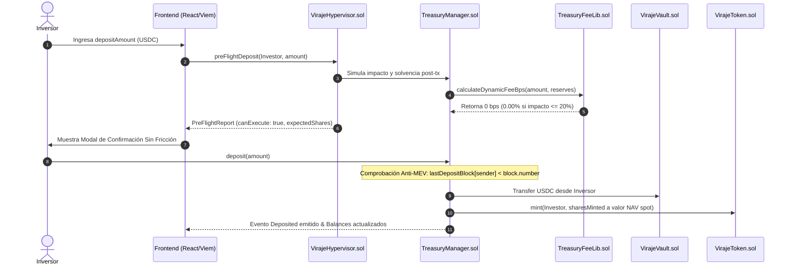
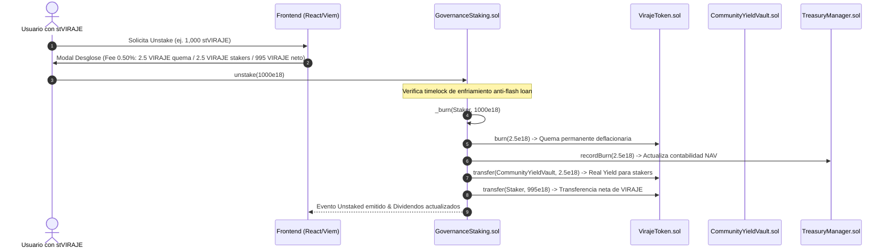

# Especificación Técnica y Arquitectura Institucional: Protocolo Viraje Protocol (v7.0 Enterprise Pure DeFi - Mainnet Ready)

**Versión:** 7.0.0-Institutional (Pure DeFi)  
**Fecha:** Noviembre 2026  
**Clasificación:** Infraestructura Descentralizada Institucional (Pure DeFi / MiCA Considerando 22)  
**Red Canónica:** Arbitrum Sepolia (`421614`) / Arbitrum One (`42161`)  

---

## 1. Visión General, Filosofía & Invariantes Institucionales

El **Protocolo Viraje Protocol** es una infraestructura financiera descentralizada (*Pure DeFi*) de grado institucional diseñada para la emisión, custodia y comercialización de un activo patrimonial de cuota de reserva respaldado por colateral exógeno ($VIRAJE$). El protocolo opera de forma inmutable sobre Ethereum Virtual Machine (EVM) y capas de escalado Layer-2 (Arbitrum), integrando gobernanza timelocked de cero privilegios corporativos, oráculos multicapa de alta resiliencia, un centinela pre-transaccional de simulación de invariantes ([`VirajeHypervisor.sol`](../contracts/src/VirajeHypervisor.sol)) y un mercado monetario Peer-to-Peer (P2P) colateralizado por Tokens No Fungibles (NFTs ERC-721).

### 1.1. Invariantes Matemáticas y Defensas Formales

El núcleo determinista del protocolo se rige por cinco invariantes matemáticas estrictas que son verificadas on-chain en tiempo real antes de confirmar cualquier transacción de emisión, rescate, colateralización o distribución de comisiones:

#### 1. Invariante de Proof of Reserves (PoR) $\ge 100.00\%$
Cada token $VIRAJE$ emitido y en circulación libre está respaldado en todo momento por reservas líquidas y exógenas de primera línea (USDC, WBTC, WETH). En ningún momento el pasivo circulante puede exceder el valor neto realizable de la reserva:

$$\text{ProofOfReservesRatio} = \frac{\text{TotalAssetsUSD}_{\text{exogenous}}}{\text{TotalLiabilitiesUSD}_{\text{circulating}}} \ge 1.0000 \quad (100.00\%)$$

#### 2. Monotonicidad Estricta del NAV Spot ($\Delta NAV_{\text{spot}} \ge 0$)
Ninguna operación dentro del protocolo (depósito, rescate, emisión de bonos vestados, préstamo P2P, liquidación por oráculo o quema deflacionaria) puede resultar en una disminución del Valor Patrimonial Neto por share ($NAV_{\text{spot}}$). Si una transacción degradara el NAV por share, el contrato de validación [`ProtocolTokenomicsEngine.sol`](../contracts/src/ProtocolTokenomicsEngine.sol) y [`TreasuryManager.sol`](../contracts/src/TreasuryManager.sol) emiten un `revert` atómico:

$$NAV_{\text{spot}} = \frac{\text{NetEquityUSD}_{\text{exogenous}}}{\text{NetCirculatingShares}_{\text{VIRAJE}}}$$

$$NAV_{t+1} \ge NAV_t$$

#### 3. Centinela de Invariantes Pre-Vuelo (`VirajeHypervisor.sol`)
Para erradicar transacciones fallidas y proteger a los usuarios de picos de gas artificiales en MetaMask (30M gas limit por revert de EVM), el centinela evalúa la transacción antes de su envío:
* Certifica solvencia post-ejecución $\ge 100\%$.
* Verifica que el endeudamiento respete el techo prudencial de colateral reflexivo ($3,435.41 USDC máx.).
* Asegura que los oráculos Chainlink/Pyth cumplan con los límites de frescura ($\le 24\text{h}$) y que el secuenciador L2 esté activo.

#### 4. Cumplimiento Regulatorio MiCA Pure DeFi (Exención Recital 22)
El protocolo prescinde de cualquier figura corporativa centralizada, custodios fiduciarios, llaves privadas de administración o denominaciones de vehículos de inversión sujetas a autorización ART (*Asset-Referenced Tokens* de acuerdo con el Reglamento EU 2023/1114). Todas las cuotas generadas se distribuyen de manera inmutable: 50% a reservas (acreciendo NAV) y 50% a [`CommunityYieldVault.sol`](../contracts/src/CommunityYieldVault.sol) para dividendos líquidos de stakers.

#### 5. Protección Anti-MEV y Cooldown Same-Block
Para neutralizar ataques atómicos de sándwich y arbitraje de NAV mediante *Flash Loans* en el mismo bloque de ejecución, los contratos de tesorería imponen una restricción de altura de bloque por cuenta:

$$\text{require}(\text{lastDepositBlock}[\text{msg.sender}] < \text{block.number}, \text{"Same-block deposit/redeem cooldown"})$$

---

## 2. Topología General de Arquitectura y Diagramas de Flujo

### 2.1. Mapa Completo de Componentes por Capas

```mermaid
graph TD
    subgraph UI ["CAPA DE PRESENTACIÓN (React 18 + Vite + Viem)"]
        Shell["App.tsx (Main Layout & Providers)"]
        Web3State["useWeb3State.ts (Polling Multi-Call Reader)"]
        DashboardUI["MetricsDashboard.tsx (PoR, Solvency & Proof of Reserves)"]
        TreasuryUI["TreasuryDashboard.tsx (Deposit USDC 0% / Redeem VIRAJE 1%)"]
        StakingUI["GovernanceStakingUI.tsx (stVIRAJE Real Yield Pool: 0% in / 0.50% out)"]
        BondsUI["VestedVaults.tsx (NFT Bond Engine: 10%-50% Descuento)"]
        P2PUI["P2PMarketplace.tsx (P2P Collateralized Lending: 6.00% APR)"]
        GovUI["GovernanceCommandCenter.tsx (DAO Timelock Proposals 72h)"]
        ModalApy["ApyBreakdownModal.tsx (On-Chain Yield Oracle Math)"]
    end

    subgraph ONCHAIN ["CAPA SMART CONTRACTS (Solidity 0.8.20 + OpenZeppelin v5)"]
        Registry["ProtocolAddressProvider.sol (Service Locator Registry)"]
        Hypervisor["VirajeHypervisor.sol (Pre-Flight Sentinel & Invariant Simulator)"]
        
        subgraph CORE ["Núcleo de Emisión, Tesorería & Librerías EIP-170"]
            Treasury["TreasuryManager.sol (Pure DeFi NAV & Orchestrator)"]
            FeeLib["TreasuryFeeLib.sol (Dynamic Slippage & Anti-Whale)"]
            PoRLib["TreasuryPoRLib.sol (Proof of Reserves & Solvency Audit)"]
            RebalanceLib["TreasuryRebalanceLib.sol (Optimal Multi-Asset Swaps)"]
            Vault["VirajeVault.sol (Exogenous Asset Cold Bunker)"]
            Token["VirajeToken.sol (ERC-20 VIRAJE)"]
            Engine["ProtocolTokenomicsEngine.sol (Pure Math Engine)"]
            Buyback["DiscountBuybackEngine.sol (10-Lock Buyback & Burn)"]
        end

        subgraph ORACLES ["Oráculos, Seguridad L2 & Post-Quantum"]
            PriceHub["OracleHub.sol (Dual Oracles + L2 Sequencer Grace Period)"]
            YieldOracle["DynamicYieldOracleRouter.sol (Passive Yield APYs)"]
            Breaker["CircuitBreaker.sol (Volatility Freeze Guard)"]
            PQGuard["PostQuantumGuard.sol (W-OTS+ NIST SP 800-208 Signatures)"]
        end

        subgraph YIELD ["Ecosistema Real Yield & Gobernanza DAO"]
            Staking["GovernanceStaking.sol (stVIRAJE & Voting Checkpoints)"]
            Router["RealYieldRouter.sol (50/50 Universal Fee Enforcer)"]
            YieldVault["CommunityYieldVault.sol (50% Staker Dividends)"]
            Governor["GovernorViraje.sol (DAO Executive)"]
            Timelock["TimelockController.sol (72h Delay)"]
        end

        subgraph MARKET ["Mercados Monetarios & Productos Estructurados"]
            VestedVault["VestedDiscountVault.sol (Bond Discount Pricing 10%-50%)"]
            NFT["VaultPositionNFT.sol (ERC-721 Collateral NFT - Packed Storage)"]
            P2P["P2PLendingMarket.sol (Escrow & Asymmetric Grace Period)"]
            Morpho["MorphoYieldVaultAdapter.sol (80% MetaMorpho Yield)"]
        end
    end

    Shell --> Web3State
    Web3State --> Registry
    Web3State --> Hypervisor
    Web3State --> Treasury
    Web3State --> Staking
    
    TreasuryUI --> Hypervisor
    Hypervisor --> Treasury
    Treasury --> FeeLib
    Treasury --> PoRLib
    Treasury --> RebalanceLib
    Treasury --> Vault
    Treasury --> Engine
    
    StakingUI --> Staking
    Staking --> Router
    BondsUI --> VestedVault
    P2PUI --> P2P
    P2P --> NFT
    P2P --> Treasury
    
    Router --> Vault
    Router --> YieldVault
```



---

### 2.2. Diagrama de Secuencia: Acuñación Sin Fricción (0.00%) y Reparto de Rendimiento



---

### 2.3. Diagrama de Secuencia: Des-staking con Comisión de Salida (0.50%)



---

## 3. Especificación Detallada de los 28 Smart Contracts y Librerías

### 3.1. Módulo 1: Núcleo de Emisión y Tesorería Exógena

#### 0. [`TreasuryProxy.sol`](../contracts/src/TreasuryProxy.sol)
- **Propósito**: Proxy de actualización canónico EIP-1967 que canaliza la ejecución y preserva el estado y fondos de la tesorería institucional delegando en `TreasuryManager.sol`.
- **Invariante de Almacenamiento**: No declara variables secuenciales en almacenamiento (slots 0, 1... libres); utiliza exclusivamente los slots de constantes canónicas EIP-1967 (`keccak256("eip1967.proxy.implementation") - 1` y `keccak256("eip1967.proxy.admin") - 1`), erradicando colisiones de almacenamiento con librerías o implementaciones.
- **Seguridad y Gobernanza**: Las funciones administrativas (`upgradeTo`, `upgradeToAndCall`, `changeAdmin`) están restringidas a `onlyOwner` (asignado incondicionalmente a `TimelockController.sol` con retardo obligatorio de 72 horas en producción). Soporta migraciones atómicas con propagación de errores (`revert`) y enrutamiento canónico seguro de `receive()` y `fallback()`.

#### 1. [`TreasuryManager.sol`](../contracts/src/TreasuryManager.sol)
- **Propósito**: Orquestador central de emisión a NAV, rescates, rebalanceos y control estricto de solvencia.
- **Modularización EIP-170**: Para permanecer por debajo del límite de 24.576 bytes, delega su lógica matemática en `TreasuryFeeLib`, `TreasuryPoRLib` y `TreasuryRebalanceLib`.
- **Invariantes Financieros y Regulatorios**:
  - **Monotonicidad de NAV ($\Delta NAV \ge 0$)**: Impide matemáticamente que cualquier depósito o rescate reduzca el valor patrimonial neto por share.
  - **Monotonicidad de Solvencia ($\Delta \text{Solvency} \ge 0$)**: Exige que el ratio de colateralización de Proof of Reserves no decaiga.
  - **Inmunidad Anti-MEV / Flash Loans**: `SameBlockCooldown` prohíbe interactuar en depósito y rescate dentro del mismo bloque para el usuario o beneficiario.
  - **Facilidad de Crédito P2P (C-03)**: Limita la exposición agregada de préstamos de tesorería a un máximo configurable del 20% (techo institucional incondicional del 50%) de las reservas líquidas de stablecoins.
  - **Deducción de Pasivos Vested (C-02)**: Ejecuta `_accrueVestedVault()` antes de cada cómputo de NAV para garantizar la valoración justa del equity neto.
  - **Aislamiento Regulatorio (C-01)**: Vincula criptográficamente `msg.sender` con el beneficiario en rescates para blindar el perímetro KYC.
- **Funciones Principales**:
  - `deposit(uint256 stableAmount)`: Acuña participaciones VIRAJE a valor NAV spot exacto. Para transacciones normales (<20% de reserva), la comisión es estrictamente **`0.00%`**.
  - `redeem(uint256 sharesAmount)`: Destruye participaciones VIRAJE, verifica la monotonicidad de NAV y retiene una comisión de salida fija del **`1.00%`** (50% acrece reservas / 50% dividendos en `CommunityYieldVault`).
  - `getNetEquityUSD()`: Computa el Patrimonio Neto Libre deduciendo la deuda exigible por bonos vestados de los activos exógenos totales.
  - `getNAVPerShare()`: Calcula el NAV spot dividiendo el Patrimonio Neto Libre entre las participaciones netas en circulación ($NAV = \text{NetEquityUSD} / \text{NetCirculatingShares}$).

#### 2. [`TreasuryFeeLib.sol`](../contracts/src/lib/TreasuryFeeLib.sol)
- **Propósito**: Cálculo algorítmico determinista de slippage dinámico, tarifas anti-dilución y comisiones de rescate.
- **Directiva de Cero Fricción**: Si el impacto del depósito es inferior o igual al 20.00% del pool (`impactRatio <= WHALE_IMPACT_THRESHOLD_BPS` = 2000 bps), retorna estrictamente **`BASE_FEE_BPS` (0.00%)**. Si excede el 20%, aplica recargo anti-dilución proporcional al impacto excedente con un tope incondicional de 200 BPS (2.00%).
- **Comisiones de Salida y Emergencia**: Aplica comisión fija de salida del **`1.00%`** (`STANDARD_REDEMPTION_FEE_BPS` = 100, 50% acrece NAV / 50% yield a stakers) y tarifa de retención de emergencia del **`5.00%`** (`EMERGENCY_FEE_BPS` = 500) en rescates de cuentas revocadas de KYC. Ambas liquidaciones emplean división truncada al suelo (sub-aditiva) para blindar a la tesorería contra fugas por redondeo.

#### 3. [`TreasuryPoRLib.sol`](../contracts/src/lib/TreasuryPoRLib.sol)
- **Propósito**: Cómputo $O(1)$ de Proof of Reserves, valoración patrimonial en tiempo real y deducción rigurosa de pasivos de bonos vestados.
- **Aislamiento de Fallos en Cascada**: Encapsula todas las consultas a adaptadores externos ERC-4626 y mercados P2P en bloques `try/catch` estructurados para garantizar que la indisponibilidad de terceros no impida la auditoría de solvencia ni las transacciones nucleares. Descuenta rigurosamente todas las participaciones en posesión del protocolo (bóveda fría, vesting de fundadores y bóveda comunitaria de staking) para calcular las acciones netas en circulación exactas.

#### 3b. [`TreasuryLiquidityLib.sol`](../contracts/src/lib/TreasuryLiquidityLib.sol)
- **Propósito**: Gestión del búfer líquido de stablecoins y desinversión automatizada de bóvedas de rendimiento ERC-4626 ante rescates o desembolsos de crédito P2P.
- **Cascada de Liquidez y Resiliencia**: Consume prioritariamente el saldo ocioso en `VirajeVault`; en caso de déficit, desinvierte de forma acotada (máximo 10 adaptadores, `MAX_ADAPTER_SCAN_LIMIT`) con llamadas `withdraw` encapsuladas en `try/catch` anidado, asegurando que pausas o iliquidez en protocolos externos nunca bloqueen las redenciones de los usuarios.

#### 4. [`TreasuryRebalanceLib.sol`](../contracts/src/lib/TreasuryRebalanceLib.sol)
- **Propósito**: Ejecución de rebalanceos de cartera multiactivo con tolerancia máxima de slippage del 0.05% contra oráculos Chainlink.

#### 5. [`VirajeVault.sol`](../contracts/src/VirajeVault.sol)
- **Propósito**: Búnker frío de custodia de reservas exógenas (USDC, WBTC, WETH). Fondos transferibles únicamente mediante roles autorizados (`VAULT_MANAGER_ROLE`). Inmune a reentrancia al carecer de estado mutable financiero. Emite eventos con operador (`FundsTransferred`, `FundsApproved`) e implementa reseteo preventivo de allowance para compatibilidad universal con tokens no estándar (ej. USDT).

#### 6. [`VirajeToken.sol`](../contracts/src/VirajeToken.sol)
- **Propósito**: Token ERC-20 representativo de cuota patrimonial (Shares) respaldado al 100% por reservas exógenas a NAV. Emite eventos institucionales de trazabilidad (`SharesMinted`, `SharesBurned`). Acuñación restringida a `MINTER_ROLE` (`TreasuryManager`) y quema a `BURNER_ROLE` (`TreasuryManager`, `GovernanceStaking`, `DiscountBuybackEngine`). Soporta aprobaciones sin gas (EIP-2612 Permit). Excluye `ERC20Votes` para delegar el gobierno a `stVIRAJE`, eliminando ataques de gobernanza vía Flash Loans.

---

### 3.2. Módulo 2: Centinela Pre-Transaccional, Oráculos y Resiliencia L2

#### 7. [`VirajeHypervisor.sol`](../contracts/src/VirajeHypervisor.sol)
- **Propósito**: Centinela pre-transaccional de grado institucional.
- **Estructura PreFlightReport**:
  ```solidity
  struct PreFlightReport {
      bool canExecute;
      uint256 expectedNAV;
      uint256 dynamicFeeBps;
      uint256 maxSafeAmount;
      string rejectionReason;
  }
  ```
- **Capacidades**: Simula llamadas antes del envío a la red, certifica que los límites LTV de colateral reflexivo no se sobrepasen y previene que MetaMask infle el gas a 30M por reversiones de contrato.

#### 8. [`OracleHub.sol`](../contracts/src/OracleHub.sol)
- **Propósito**: Concentrador central de oráculos multicapa con detección de caídas del Secuenciador L2 de Arbitrum (periodo de gracia de 1 hora).
- **Failover Automático Protegido**: Oráculo primario Chainlink con validación de staleness (1 hora por defecto) y conmutación determinista blindada mediante `try/catch` a oráculo secundario (Pyth/Redundante), con control de divergencia máxima del 5% acotado a cachés primarias recientes (antigüedad $\le$ 24 horas) para erradicar falsos positivos.

#### 8b. [`DynamicYieldOracleRouter.sol`](../contracts/src/DynamicYieldOracleRouter.sol)
- **Propósito**: Motor dinámico de descubrimiento y optimización cuantitativa de rendimientos APY para reservas de tesorería (Morpho Blue, Lido, Lombard/Babylon).
- **Protección Cuantitativa**: Límites de prudencia financiera (Sanity Bounds) con techo incondicional del 50.00% APY. Despliega el 90% de los stablecoins en rendimiento pasivo institucional y retiene el 10% en colchón líquido en `VirajeVault.sol`. Garantiza la exclusión estricta de bóvedas no verificadas.

#### 9. [`CircuitBreaker.sol`](../contracts/src/CircuitBreaker.sol)
- **Propósito**: Interruptor de seguridad de volatilidad. Congela temporalmente las órdenes de compra de un activo colateral si su cotización cae más de un 15% en una ventana deslizante de 6 horas.
- **Resiliencia Operativa**: Emplea un búfer circular anular acotado ($O(1)$) de 50 muestras cronológicas con tasa de muestreo mínima de 15 minutos (inmune a vector de Gas DoS o manipulación intra-bloque), límite de staleness de oráculo de 1 hora por defecto y consultas a Chainlink encapsuladas en `try/catch` estructurado para garantizar continuidad de keepers. Control dual de emergencia (`ADMIN_ROLE` y `EMERGENCY_ADMIN_ROLE`).

#### 10. [`PostQuantumGuard.sol`](../contracts/src/PostQuantumGuard.sol)
- **Propósito**: Capa de seguridad criptográfica post-cuántica mediante firmas hash Winternitz W-OTS+ (NIST SP 800-208 / 128 bits de seguridad Grover).

---

### 3.3. Módulo 3: Flujo Real Yield y Gobernanza DAO

#### 11. [`RealYieldRouter.sol`](../contracts/src/RealYieldRouter.sol)
- **Propósito**: Distribuidor binario universal de comisiones (50/50). 50% inyectado en `VirajeVault` (acrece NAV spot de todos los tenedores) y 50% a `CommunityYieldVault` (dividendos en USDC a stakers de `stVIRAJE`).

#### 12. [`CommunityYieldVault.sol`](../contracts/src/CommunityYieldVault.sol)
- **Propósito**: Bóveda comunitaria que almacena y distribuye el flujo de dividendos de Real Yield en tiempo real.

#### 13. [`GovernanceStaking.sol`](../contracts/src/GovernanceStaking.sol)
- **Propósito**: Staking líquido de gobernanza (`stVIRAJE`) con puntos de control de voto ERC-20 Votes.
- **Comisiones**: Entrada **`0.00%`** (1:1 stVIRAJE sin coste). Salida (Unstake) **`0.50%`** (50% quema deflacionaria / 50% distribuido a stakers leales).

#### 14-15. [`GovernorViraje.sol`](../contracts/src/GovernorViraje.sol) & [`TimelockController.sol`](../contracts/src/TimelockController.sol)
- **Propósito**: Gobernanza descentralizada con retardo obligatorio de 72 horas para toda modificación administrativa o de código.

---

### 3.4. Módulo 4: Mercados Monetarios y Productos Estructurados

#### 16. [`VestedDiscountVault.sol`](../contracts/src/VestedDiscountVault.sol)
- **Propósito**: Emisión de bonos cupón cero pre-financiados con plazos de 1 a 5 años y escala de descuento del **10.0% al 50.0%** (10% anual base). Cero comisión de emisión (`mintFeeBps = 0`). Opción de *ragequit* con 15% de penalización y quema del 100% de tokens no vestados.

#### 17. [`VaultPositionNFT.sol`](../contracts/src/VaultPositionNFT.sol)
- **Propósito**: Token ERC-721 transferible con almacenamiento compacto de parámetros de posición de bonos.

#### 18. [`P2PLendingMarket.sol`](../contracts/src/P2PLendingMarket.sol)
- **Propósito**: Mercado de préstamos sobrecolateralizados bilaterales y línea de liquidez directa de Tesorería.
- **Parámetros Calibrados**:
  - **Tasa Fija Tesorería**: **`6.00% APR`**.
  - **Comisión de Originación**: **`0.25%`** (destinada a stakers).
  - **LTV Efectivo Bonos NFT**: **`45.50%`** (Haircut del 65% $\times$ 70% Max LTV).
  - **LTV Máximo WBTC**: **`75.00%`**.
  - **LTV Máximo WETH**: **`80.00%`**.
  - **LTV Efectivo VIRAJE**: **`25.00%`** (Haircut del 50% $\times$ 50% Max LTV).
  - **Techo Colateral Reflexivo**: **`45.00%`** ($3,435.41 USDC máx.).
  - **Defensa Asimétrica en Sequencer Grace Period**: Amortizaciones permitidas, liquidaciones pausadas temporalmente.

#### 19. [`DiscountBuybackEngine.sol`](../contracts/src/DiscountBuybackEngine.sol)
- **Propósito**: Recompra algorítmica de VIRAJE con descuento ($\ge 5\%$) en mercados secundarios y quema atómica con 10 candados de control matemático.

#### 20. [`MorphoYieldVaultAdapter.sol`](../contracts/src/MorphoYieldVaultAdapter.sol)
- **Propósito**: Adaptador ERC-4626 que canaliza el 80% de las stablecoins hacia MetaMorpho para devengo pasivo institucional de rendimiento.

---

## 4. Formulativa Matemática y Ecuaciones del Protocolo

### 4.1. Tarifa Dinámica Adaptativa Anti-Ballena
$$\text{DynamicFeeBps} = \begin{cases} 
0 & \text{si } \text{ImpactRatio} \le 2000\text{ bps (20\%)} \\
\min\left(200, \, \frac{(\text{ImpactRatio} - 2000) \times \text{Sensitivity}}{10000}\right) & \text{en otro caso}
\end{cases}$$

### 4.2. Acuñación de Participaciones VIRAJE por NAV
$$\text{SharesToMint} = \begin{cases} 
\text{DepositUSD}_{18} & \text{si } \text{TotalShares} = 0 \text{ o } \text{TotalAssetsUSD} = 0 \\
\frac{\text{DepositUSD}_{18} \times 10^{18}}{NAV_{\text{spot}}} & \text{en otro caso}
\end{cases}$$

### 4.3. Escala de Descuento en Bonos Vestados
$$\text{Discount}_{\text{BPS}} = \min \left( 5000, \, (\text{LockYears} \times 1000) + \text{TierBonus}_{\text{stVIRAJE}} \right)$$

### 4.4. Capacidad de Crédito P2P para Bonos NFT
$$\text{MaxBorrowAllowed} = \frac{\text{DiscountedPricePaid} \times \text{Haircut}_{\text{BPS}} \times \text{MaxLTV}_{\text{BPS}}}{10000 \times 10000} = \text{DiscountedPricePaid} \times 0.455$$

---

## 5. Capa de Frontend y Estado React (Viem + TypeScript)

La aplicación frontend implementa una arquitectura **Pure UI Rendering** donde la interfaz actúa de forma puramente reactiva al estado devuelto por los smart contracts:

| Hook | Responsabilidad y Lecturas/Escrituras On-Chain |
| :--- | :--- |
| `useWeb3State.ts` | Polling reactivo mediante Viem `publicClient`. Lee balances, PoR, NAV spot, APYs y préstamos P2P. |
| `useTreasuryActions.ts` | Ejecución de `deposit(usdc)` con 0.00% fee y `redeem(viraje)` con 1.00% fee. |
| `useStakingActions.ts` | Staking 1:1 sin comisión de entrada y unstaking con 0.50% de comisión de salida. |
| `useVestedVaultActions.ts` | Emisión de bonos NFT a 10%-50% de descuento y ejecuciones de `ragequit(-15%)`. |
| `useP2PLendingActions.ts` | Creación de ofertas P2P, financiación, créditos de tesorería al 6% APR y liquidaciones protegidas. |

---

## 6. Matriz de Control de Acceso (RBAC) y Cumplimiento MiCA

| Rol On-Chain | Identificador (`bytes32`) | Asignación Contractual en Producción | Permisos & Responsabilidad Operativa |
| :--- | :--- | :--- | :--- |
| `ROOT_ADMIN_ROLE` | `0x00` (`DEFAULT_ADMIN_ROLE`) | `TimelockController.sol` (72h) | Concesión y revocación exclusiva de roles. Cero llaves privadas administradoras. |
| `ADMIN_ROLE` | `keccak256("PROTOCOL_ADMIN_ROLE")` | `TimelockController.sol` (72h) | Modificación y ajuste de parámetros fiduciarios operativos (slippage, pools, límites). |
| `EMERGENCY_ADMIN_ROLE` | `keccak256("EMERGENCY_ADMIN_ROLE")` | `CircuitBreaker.sol` & Timelock | Activación de pausas defensivas y cortafuegos de volatilidad. |
| `TIMELOCK_ADMIN_ROLE` | `keccak256("TIMELOCK_ADMIN_ROLE")` | `TimelockController.sol` | Administración interna de parámetros del timelock de ejecución. |
| `PROPOSER_ROLE` | `keccak256("PROPOSER_ROLE")` | `GovernorViraje.sol` | Encolado de propuestas de gobernanza aprobadas por la comunidad stVIRAJE. |
| `EXECUTOR_ROLE` | `keccak256("EXECUTOR_ROLE")` | `address(0)` (Permisionless) | Ejecución descentralizada de transacciones una vez transcurrido el retardo de 72h. |
| `CANCELLER_ROLE` | `keccak256("CANCELLER_ROLE")` | `GovernorViraje.sol` & Timelock | Cancelación de propuestas encoladas ante detección de fallos o exploits. |
| `VAULT_MANAGER_ROLE` | `keccak256("VAULT_MANAGER_ROLE")` | `TreasuryManager.sol`, `DiscountBuybackEngine.sol` | Extracción y autorización de fondos en `VirajeVault.sol`. |
| `RESERVE_MANAGER_ROLE`| `keccak256("RESERVE_MANAGER_ROLE")` | `TimelockController.sol` | Ajuste de ponderaciones de activos de reserva y límites prudenciales. |
| `YIELD_ROUTER_ROLE` | `keccak256("YIELD_ROUTER_ROLE")` | `RealYieldRouter.sol` | Enrutamiento y reparto atómico 50/50 de rendimientos reales. |
| `MINTER_ROLE` | `keccak256("MINTER_ROLE")` | `TreasuryManager.sol` | Acuñación exclusiva de participaciones $VIRAJE$ respaldadas por colateral a NAV. |
| `BURNER_ROLE` | `keccak256("BURNER_ROLE")` | `TreasuryManager.sol`, `DiscountBuybackEngine.sol` | Destrucción de participaciones en rescates y recompras deflacionarias. |
| `ORACLE_MANAGER_ROLE` | `keccak256("ORACLE_MANAGER_ROLE")` | `TimelockController.sol` | Registro y conmutación de feeds Chainlink/Pyth y límites de staleness. |
| `COMPLIANCE_ROLE` | `keccak256("COMPLIANCE_ROLE")` | Pasarela de Verificación MiCA | Habilitación de estatus KYC institucional para participantes mayoristas. |
| `KEEPER_ROLE` | `keccak256("KEEPER_ROLE")` | Keeper Bots de Protocolo | Ejecución de recompras con descuento y mantenimiento periódico. |
| `QUANTUM_OPERATOR_ROLE`| `keccak256("QUANTUM_OPERATOR_ROLE")` | `PostQuantumGuard.sol` | Verificación de firmas criptográficas hash W-OTS+ y migraciones cuánticas. |

---

## 7. Arquitectura L2 & Resiliencia Off-Chain

* **L2 Sequencer Grace Period:** Ante caídas o reinicios del secuenciador de Arbitrum, se permite amortizar deuda (`repayLoan`), pero las liquidaciones forzosas (`liquidateLoan`) quedan pausadas para impedir liquidaciones con datos de oráculo congelados.
* **Indexación Off-Chain con Detección de Reorgs:** `BlockIndexer.ts` valida `parentHash` y ejecuta rollbacks atómicos mediante `IdempotentLedgerEngine.ts`, asegurando consistencia patrimonial continua.
* **Blindaje Post-Cuántico W-OTS+:** Implementación de firmas Winternitz hash de 128 bits de seguridad Grover evaluadas en gas nativo EVM sin precompilados experimentales.
